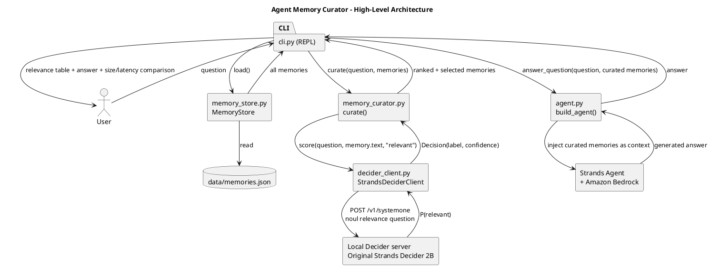

# Agent Memory Curator

A CLI coding-assistant agent for the **Strands Decider Agent Hackathon**. Before every
answer, it scores the relevance of each stored memory against the current question
(the "context and memory" decision pattern), keeps only memories above a confidence
threshold, and hands that curated context to an Amazon Bedrock-backed Strands `Agent`
for the final answer.

Tags: `#strands-decider-2b` `#context-memory`

## Submission Status

The CLI defaults to `StrandsDeciderClient`, using the official Decider 2B HTTP
server and the original `StrandsAgents/strands-decider-2B-qwen3.5-v1-2610` model.
The reusable pattern is a typed `noul` (yes/no) relevance question. Its returned
P(true) is used as P(relevant), not the separate confidence of a `choice` answer.
`--backend mock` is for development only and does not qualify as real model use.

This repository uses the [MIT license](LICENSE). Before submission: verify and
record a successful real Decider-to-Bedrock run, publish the Builder Center article,
and supply a public demo video under three minutes on YouTube, Vimeo, Facebook Video,
or Youku. Local tests alone do not establish hackathon qualification.
Apply both tags in Builder Center, and confirm participant eligibility and originality.
The deadline in the supplied rules is October 23, 2026, at 11:59 p.m. PT.

Live validation on October 16: the official 2B server on MPS successfully scored
51 memories across three questions and selected the expected testing, threshold,
and AWS-error conventions. The CLI then reached Bedrock, but its answer request
failed with `ExpiredTokenException`. Renew AWS session credentials before rerunning
the smoke command; a successful end-to-end answer has not yet been demonstrated.

## Why

Sending every stored memory increases prompt size and can introduce unrelated
context. This prototype asks "is this memory relevant to the question?" for every
memory before generation, then sends only the selected subset to Bedrock.
Selection can omit useful memories; a smaller prompt does not establish better
answers, lower total cost, or lower end-to-end latency. The current mock adds about
115 ms of simulated delay per memory only in mock mode. Reported token counts estimate memory text
size only, not complete requests or billed usage.

## Reusable decision pattern (the asset others can reuse)

**Files:** [`decider_client.py`](./decider_client.py) and [`memory_curator.py`](./memory_curator.py)

- **Typed question/option set:** `score(question: str, context: str, option: str) -> Decision`,
  where `Decision = {label: str, confidence: float}`. The HTTP request uses a `noul`
  question: "Is the memory directly useful for answering the user's question?"
  Its implicit options are true/false. State contains the user question and one memory;
  `Decision.confidence` stores the returned probability of true, or P(relevant).
- **Wiring that places it in the agent's path:** [`memory_curator.py`](./memory_curator.py)
  calls `decider.score(question, memory.text, "relevant")` once per stored memory, ranks by
  confidence descending, and keeps entries scoring `>= THRESHOLD` (default `0.6`), capped at
  `MAX_MEMORIES` (default `5`).
- **How to use it in your own agent:**

  ```python
  from decider_client import StrandsDeciderClient
  from memory_curator import curate, selected_memories
  from memory_store import MemoryStore

  decider = StrandsDeciderClient(base_url="http://127.0.0.1:8000")
  memories = MemoryStore("data/memories.json").load()
  ranked = curate("How do we organize unit tests?", memories, decider)
  context_to_inject = selected_memories(ranked)
  ```

  `decider_client.py` has zero Bedrock/Strands/AWS imports, so the pattern drops into any
  agent regardless of generative backend. It implements the official
  `POST /v1/systemone` contract, checks the returned model name, and rejects invalid
  probabilities. The curator excludes failed scores; if every score fails, the CLI
  skips Bedrock rather than silently bypassing the decision step.

## Architecture

Source diagram: [`docs/architecture.puml`](./docs/architecture.puml)



## Setup

The application needs Python 3.11+. Run inference in a separate Python 3.13
environment to avoid tying its PyTorch requirements to the application interpreter.
Start the official Decider server in one terminal (macOS Apple silicon):

```bash
python3.13 -m venv .venv-decider
.venv-decider/bin/python -m pip install "strands-decider==0.1.0"
.venv-decider/bin/strands-decider serve StrandsAgents/strands-decider-2B-qwen3.5-v1-2610 --device mps --port 8000
```

Use `--device cpu` on hosts without a supported GPU, or `--device cuda` in an
appropriately configured NVIDIA environment. First use downloads the adapter and
base weights (the base is approximately 4.5 GB). Wait until the server is ready.
It binds to loopback and has no authentication: do not expose it publicly.
See the [official inference guide](https://github.com/strands-labs/strands-decider/blob/main/docs/inference.md).

In a second terminal, install and run the application:

```bash
python3 -m venv .venv
source .venv/bin/activate
pip install -r requirements.txt
```

Configure AWS credentials with Bedrock access (standard `boto3` credential chain), and
optionally set `BEDROCK_MODEL_ID` (defaults to `anthropic.claude-3-5-sonnet-20241022-v2:0`).
Set `AWS_PROFILE` and `AWS_DEFAULT_REGION` for an account with permission to invoke
the selected model. Model availability varies by account and Region; an inference
profile ID may be required. Bedrock calls incur normal AWS charges.

## Run

```bash
python -m cli
```

Override the local server URL with `DECIDER_URL` or `--decider-url`. To run a
repeatable live smoke test, use full natural-language questions:

```bash
python -m cli --question "How do we organize unit tests?" --question "How should we handle AWS call failures?" --question "What is our relevance threshold?"
```

This makes real Decider and Bedrock calls; a failed turn returns a nonzero exit
status. For explicit mock scoring, use `python -m cli --backend mock`; this still
calls Bedrock for answers and is not a qualifying demo.

Each turn prints a relevance table (memory id, confidence, selected y/n) with the
decision-loop latency, the Bedrock answer, and a curated-vs-everything size comparison
(characters and estimated tokens). Bedrock answer latency is measured separately;
there is no all-memory baseline generation or claim of end-to-end speedup.

Memories are static demo fixtures, not verified historical records. Each turn uses
a fresh agent. Only reviewed, non-sensitive memories should be used: selected
texts reach Bedrock, and the CLI previews even unselected entries. Relevance is
not authorization or a prompt-injection defense.

## Tests

```bash
pytest
```

Covers `MemoryStore` (load/skip-malformed/save round-trip), `MockDeciderClient`
(deterministic scoring), and `memory_curator` (ranking, threshold filtering,
`MAX_MEMORIES` cap, empty-store case, failed/invalid scores), CLI wiring and error
recovery, and the Bedrock adapter with mocked SDK constructors. HTTP contract tests
use mocked responses. Tests make no live AWS or model calls.
