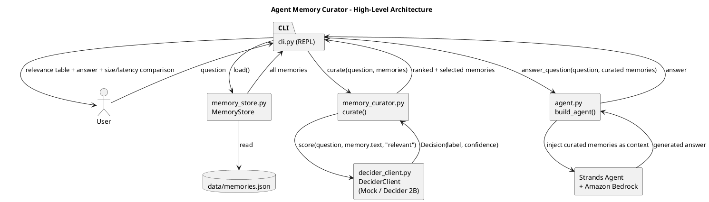

# Agent Memory Curator

A CLI coding-assistant agent for the **Strands Decider Agent Hackathon**. Before every
answer, it scores the relevance of each stored memory against the current question
(the "context and memory" decision pattern), keeps only memories above a confidence
threshold, and hands that curated context to an Amazon Bedrock-backed Strands `Agent`
for the final answer.

Tags: `#strands-decider-2b` `#context-memory`

## Why

Dumping every stored memory into an LLM prompt wastes tokens, adds latency, and dilutes
relevance. This agent runs one fast, cheap decision -- "is this memory relevant to the
question?" -- for every memory *before* the generative call, so Bedrock only ever sees a
small, high-relevance context window.

## Reusable decision pattern (the asset others can reuse)

**File:** [`decider_client.py`](./decider_client.py)

- **Typed question/option set:** `score(question: str, context: str, option: str) -> Decision`,
  where `Decision = {label: str, confidence: float}`.
- **Wiring that places it in the agent's path:** [`memory_curator.py`](./memory_curator.py)
  calls `decider.score(question, memory.text, "relevant")` once per stored memory, ranks by
  confidence descending, and keeps entries scoring `>= THRESHOLD` (default `0.6`), capped at
  `MAX_MEMORIES` (default `5`).
- **How to use it in your own agent:**

  ```python
  from decider_client import DeciderClient, MockDeciderClient
  from memory_curator import curate, selected_memories

  decider: DeciderClient = MockDeciderClient()  # swap for a real Decider 2B client
  ranked = curate(question, your_memories, decider)
  context_to_inject = selected_memories(ranked)
  ```

  `decider_client.py` has zero Bedrock/Strands/AWS imports, so the pattern drops into any
  agent regardless of generative backend. Swap `MockDeciderClient` for a real Strands
  Decider 2B client by implementing the same `DeciderClient` Protocol -- no caller code
  changes.

## Architecture

Source diagram: [`docs/architecture.puml`](./docs/architecture.puml)



## Setup

```bash
python3 -m venv .venv
source .venv/bin/activate
pip install -r requirements.txt
```

Configure AWS credentials with Bedrock access (standard `boto3` credential chain), and
optionally set `BEDROCK_MODEL_ID` (defaults to `anthropic.claude-3-5-sonnet-20241022-v2:0`).

## Run

```bash
python -m cli
```

Each turn prints a relevance table (memory id, confidence, selected y/n) with the
decision-loop latency, the Bedrock answer, and a curated-vs-everything size comparison
(characters and estimated tokens).

## Tests

```bash
pytest
```

Covers `MemoryStore` (load/skip-malformed/save round-trip), `MockDeciderClient`
(deterministic scoring), and `memory_curator` (ranking, threshold filtering,
`MAX_MEMORIES` cap, empty-store case). Bedrock calls are not exercised in unit tests.
